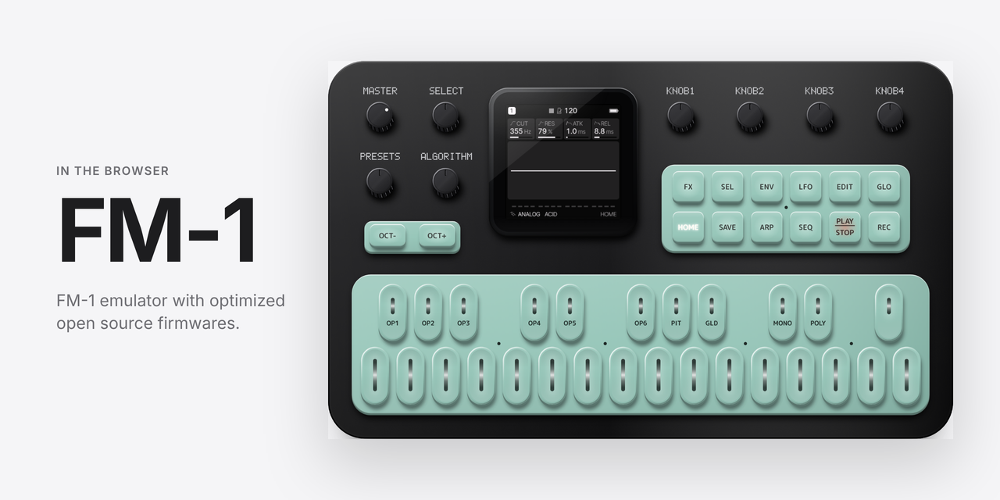

# FM-1

FM-1 emulator with optimized open source firmwares, in the browser. · [Français](README.md)

**Open: [ninjathune-human.github.io/Fm1](https://ninjathune-human.github.io/Fm1/)** in a recent Chrome, Edge, Firefox or Safari, on a computer, iPad or iPhone (mouse, touch, pencil).

## Use

- **Power on** starts the sound. **Firmware**, below the panel, opens the list (the search forgives typos). **Open a .fwsc…** runs a package from your computer; it is never uploaded.
- Each firmware keeps its presets and patterns in the browser. **Backup and restore** saves the whole FM-1 memory to a .json file. **FR / EN** switches the interface, the manual and the firmware notes.
- **Duo** (`index.html?duo`): two FM-1s on one page. With **Linked tempo** they share one MIDI clock and one PLAY starts both.

## How it works

- **86 native firmwares**, compiled from their sources to WebAssembly by a GitHub Action, with no emulated CPU. They follow their authors' new versions.
- **The 47 others** run unchanged on [fm1-emu](https://github.com/joakimeriksson/fm1-emu), Joakim Eriksson's emulator of the FM-1's chip, until they are made native or removed.
- **FM-1+VA** is a reimplementation written from Baud Girl's published manual; her firmware is not redistributed here.

The full list, with authors, licences and the exact source of each package, is in the [French README](README.md#firmwares).

## Licences

- This repository: MIT, except `index.html` (its panel is adapted from the [DUB-1 emulator](https://github.com/sbegueria/fm1-dub)) and the firmware adapters in `tools/worklets/`, which stay under GPL-3.0.
- fm1-emu: MIT, © 2026 Joakim Eriksson. Each firmware keeps its author's licence (`firmwares/licences/`). Catalogue after zvenson's [FM-1 Firmware Hub](https://thefirmwarehub.com/).
- FM-1 is a trademark of its owner. Independent project.
