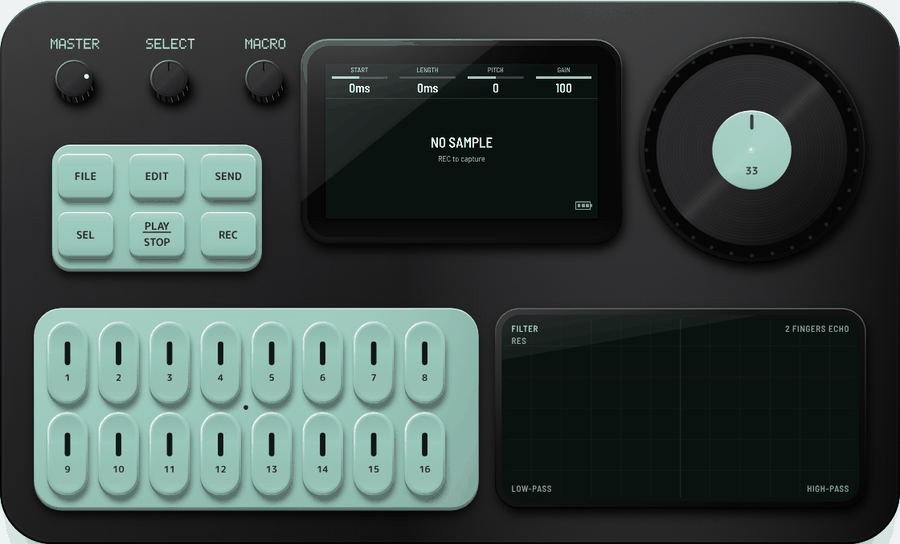

# FM-1

FM-1 emulator in the browser, with open source firmwares. · [Français](README.md)

**[ninjathune-human.github.io/Fm1](https://ninjathune-human.github.io/Fm1/)**: computer, iPad, iPhone (mouse, touch, pencil). On iPad, as an app: [FM1.ipa](https://github.com/Ninjathune-Human/Fm1/releases/download/ipad/FM1.ipa) with [Sideloadly](https://sideloadly.io/).

## Use

- **Power on**, or pick a firmware: the list opens under the panel, the search forgives typos. **Open a .fwsc…** runs a local package, never uploaded.
- Each firmware keeps its memory in the browser. **Copies** keeps named versions; **Backup and restore** exports everything to .json, in [Jake Pawlik's fork](https://github.com/jpawlik/Fm1) format.
- **Duo** (`?duo`): two FM-1s, each with its own firmware. **Linked tempo**: one MIDI clock, one PLAY starts both.
- **FR / EN** translates the interface, the manual and the sheets.

## Sample module

In the Duo, at the top of FM1-B's list: capture a sound (microphone, the FM-1 next to it, a file, a tab), cut it into 16 slices played on the pads, bend it on the platter and in the XY pad, send it to FM1-A or save it as .wav.

## How it works

- **100 native firmwares**, compiled to WebAssembly from their sources by a GitHub Action ([performance](docs/performance.md)).
- **43 emulated** on [fm1-emu](https://github.com/joakimeriksson/fm1-emu) (Joakim Eriksson), pinned at commit `60645a5`.
- **FM-1+VA** is written from Baud Girl's manual; her firmware is not redistributed.
- The `.fwsc` packages are their authors', checked by SHA-256 ([catalogue](firmwares/catalogue.json), [verification](docs/verification.md)).

The full list, with authors, licences and the exact source of each package, is in the [French README](README.md#firmwares).

## Licences

- This repository: MIT, except `index.html` (panel adapted from the [DUB-1 emulator](https://github.com/sbegueria/fm1-dub)) and the firmware adapters in `tools/worklets/`, which stay under GPL-3.0.
- fm1-emu: MIT, © 2026 Joakim Eriksson. Each firmware keeps its author's licence (`firmwares/licences/`). Catalogue after zvenson's [FM-1 Firmware Hub](https://thefirmwarehub.com/).
- FM-1 is a trademark of its owner. Independent project.
