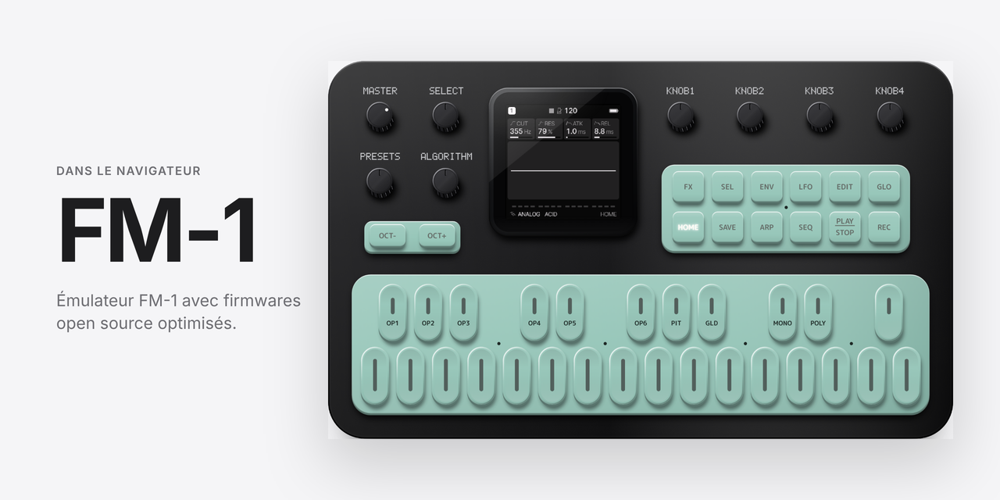

# FM-1

Émulateur FM-1 avec firmwares open source optimisés, dans le navigateur. · [English](README.en.md)

**Ouvrir : [ninjathune-human.github.io/Fm1](https://ninjathune-human.github.io/Fm1/)**, dans Chrome, Edge, Firefox ou Safari récents, sur ordinateur, iPad et iPhone (souris, tactile, stylet).

**Sur iPad, en app** : [FM1.ipa](https://github.com/Ninjathune-Human/Fm1/releases/download/ipad/FM1.ipa), le site embarqué, à installer avec [Sideloadly](https://sideloadly.io/) (avec un identifiant Apple gratuit, la signature dure 7 jours).

## Utilisation

- **Allumer** démarre le son. Le contrôle **Firmware**, sous le panneau, ouvre la liste : la recherche tolère les fautes et l'ordre des mots, Entrée démarre le premier résultat. **Ouvrir un .fwsc…** démarre un paquet de votre ordinateur, sans l'envoyer nulle part ; il reste ensuite dans la liste, sous Mes firmwares, dans ce navigateur.
- Chaque firmware garde ses presets et ses patterns dans le navigateur. L'interrupteur **marche / arrêt** éteint le FM-1 ; l'éteindre efface les sauvegardes du seul firmware actif.
- Sous le panneau : le manuel, les raccourcis clavier, les fonctions du firmware chargé, et **Sauvegarde et restauration**, toute la mémoire du FM-1 dans un fichier .json, au format du [fork de Jake Pawlik](https://github.com/jpawlik/Fm1) (une sauvegarde passe d'un site à l'autre). **FR / EN** traduit l'interface, le manuel et les fiches.
- **Duo** (`index.html?duo`) : deux FM-1 dans la page, chacun avec son firmware et sa mémoire. Avec **Tempo lié**, la page leur donne la même horloge MIDI au BPM choisi et un PLAY lance les deux ; seuls se choisissent alors les firmwares vérifiés en Duo. L'horloge vient du fork de Jake Pawlik.
- **Fichier MIDI** : avec SLOOP, un fichier .mid entre dans une piste, comme par « Import MIDI » de [son éditeur web](https://github.com/isod89/sloop-fm1), dont la page parle le protocole.

## Comment ça marche

- **86 firmwares natifs** : une action GitHub les compile depuis leurs sources en WebAssembly, sans processeur émulé ([performances](docs/performance.md)). Ce sont eux qui suivent les nouvelles versions de leurs auteurs.
- **Les 47 autres** tournent tels quels sur [fm1-emu](https://github.com/joakimeriksson/fm1-emu), l'émulateur de la puce JieLi AC791N du FM-1 écrit par Joakim Eriksson, compilé au commit figé `60645a5`. Ils restent à leur version, en attendant d'être intégrés en natif ou retirés.
- **FM-1+VA** est une réimplémentation écrite d'après le manuel publié par Baud Girl : moteurs FM, Virtual Analog et 8-Bit, séquenceur, MIDI (Web MIDI, patches DX7 en SysEx). Son firmware n'est pas redistribué ici et aucun code n'en est repris.
- **Les LED** : sur le FM-1, un niveau entre éteint et allumé est une part du temps allumée. Le panneau dessine cette part, relevée dans les sources de chaque firmware ou mesurée par l'émulateur, telle que l'œil la perçoit.
- Les paquets `.fwsc` sont ceux de leurs auteurs, vérifiés par leur empreinte SHA-256 ([catalogue](firmwares/catalogue.json), [rapport de vérification](docs/verification.md)).

## Firmwares

« État » : vérifié (démarré ici, image et son mesurés), fonctionne (selon fm1-emu), non évalué ; « natif » : compilé depuis ses sources ; « en ligne » : paquet chargé depuis le FM-1 Firmware Hub ; « bêta » : version de test de son auteur.

<!-- firmwares -->

Officiel (1)

| Firmware | Auteur | Licence | Source | État |
|---|---|---|---|---|
| Firmware officiel V15 | Fabricant du FM-1 | Apache-2.0 | [4c7496d](https://github.com/m-vave/fm1_open/tree/4c7496daac04a95ff10d1afdcc8f9ead2dbabc41) | fonctionne |

Groovebox (48)

| Firmware | Auteur | Licence | Source | État |
|---|---|---|---|---|
| Argo | echoe | GPL-3.0 | [21fc592](https://github.com/echoe/argo_fm1/tree/21fc592dab76907b6bea34d97950dfe129ad9fd8) | fonctionne, natif |
| Bigorna | Nuno Zimas | GPL-3.0 | [3d937bf](https://github.com/nzimas/bigorna/tree/3d937bf9dae6157fb6f61dc01fb52eaf46ea1df7) | vérifié |
| Chipbox | Pasquale Barilla | GPL-3.0 | [8b3e67e](https://github.com/pbarilla/chipbox/tree/8b3e67e30443b2336c769af2481e1e997f1fa253) | fonctionne, natif |
| DARK-1 | Polystellarflow | GPL-3.0 | [3f7cd63](https://github.com/sparky480v/Dark-1/tree/3f7cd6323a168c4880a82eacdcf453389a5347d0) | vérifié |
| DUB-1 | sbegueria | GPL-3.0 | [e89138a](https://github.com/sbegueria/fm1-dub/tree/e89138a3de7d11f97c941ef467d166eb0763d160) | fonctionne, natif |
| Dungeon Tracker | BourbonWX | GPL-3.0-only | [4e43c2f](https://github.com/BourbonWX/Dungeon-Tracker/tree/4e43c2f34899237f685a10999b00213644aef394) | non évalué, natif |
| ESTAMPIE | Drew Robinson | GPL-3.0 | [57ea691](https://github.com/ocean/estampie/tree/57ea691aae13122cfb59b1f5a6518179ff029cd2) | vérifié, bêta, natif |
| EVILGENIUS | Michael P Jones (Quixotic7) | MPL-2.0 | [4441c86](https://github.com/Quixotic7/evilgenius/tree/4441c86417db88ae6eb3d601fe149457157b0d6f) | non évalué, natif |
| Felucca | Leo Kuroshita (Hügelton Instruments) | GPL-3.0 | [d7b1b7c](https://github.com/hugelton/Felucca/tree/d7b1b7c4099bba28854869ddb256b3d9f634cee8) | fonctionne, natif |
| Felucca [Salt] | Chance Roth (ChanceTheMaker) | GPL-3.0 | [9490527](https://github.com/ChanceTheMaker/Felucca/tree/949052728758229ab5ab1816ccf9fa61fafc5803) | fonctionne, bêta |
| FIZZ | Quixotic7 | MPL-2.0 | [01b5a98](https://github.com/Quixotic7/FIZZ/tree/01b5a98414d87ffce45d62997b4cd9d6bdd7364d) | vérifié, bêta |
| FM1-GM | jartificer | GPL-3.0 | [fcc7655](https://github.com/jartificer/fm1-gm/tree/fcc7655dd0bfe5a29440f99dbcadba417cf1dbc7) | fonctionne |
| GHOULBOX | Jason Persinger | GPL-3.0 | [9f2b9a2](https://github.com/jasonpersinger/ghoulbox-fm1-dungeon-synth/tree/9f2b9a22e456d7fe9552b40f7a1d0c13200913bb) | fonctionne, natif |
| Golana DZ Edition | dzwerg | GPL-3.0 | [858e3f2](https://github.com/dzwerg/Golana-DZ/tree/858e3f2f9e018f01a1c87451c712193869f0324b) | fonctionne, bêta, natif |
| GR!MM | GRiMMBIENT | GPL-3.0 | [b519acb](https://github.com/GRiMMBIENT/grimm/tree/b519acbee7dbdb3e0fb82b15b86a913898c6f8f5) | fonctionne, natif |
| HERA | Ben Badio | GPL-3.0 | [2c99af2](https://github.com/benbadio/hera-fm1/tree/2c99af2141217e1e0083da39049ace432efa1cd1) | fonctionne, natif |
| HYP-1 | RedtailWorks | GPL-3.0 | [824316e](https://github.com/RustyPawz/fm1-HYP1/tree/824316eed62a877cb0d9554ad0a80714830f51e4) | fonctionne, natif |
| Jangada | zednaked | GPL-3.0 | [46e6c2c](https://github.com/zednaked/jangada/tree/46e6c2c2ed94b609918aa6f5f7381fac915ffc45) | fonctionne |
| JIANT FM | juanjiant-bit | GPL-3.0 | [d247fd9](https://github.com/juanjiant-bit/JIANT/tree/d247fd9c311be4b33bde64d8794d6d83ec8a99b4) | fonctionne, natif |
| KARMA | Ariel Muchnik | GPL-3.0 | [23304e9](https://github.com/eatyourgreensstudio-dotcom/karma-fm1/tree/23304e93d17d12a79546879d60d58c5c3421aac5) | vérifié |
| Loom FM-1 | Co-oscillator | GPL-3.0 | [ed6f036](https://github.com/Co-oscillator/Loom-FM-1/tree/ed6f036f9e3187ba22f915c3941d23f477159683) | vérifié, bêta, natif |
| LOOM-8 | Charles Vestal | MPL-2.0 | [ffc0cd1](https://github.com/charlesvestal/fm1-loom/tree/ffc0cd1d8ca7005ef7088257f200e506e4a30a9c) | fonctionne |
| Makohai | delirioux | GPL-3.0 | [bf6646f](https://github.com/delirioux/makohai/tree/bf6646ff2dbcb6ac10a726724348d5302b37ab17) | vérifié, natif |
| MAKU | okumurari | GPL-3.0 | [5671198](https://github.com/okumurari2/maku/tree/5671198f1989cbd4a0e674b2059e7f8316faf37d) | fonctionne, natif |
| MC-1 | dspaudio | GPL-3.0 | [10a2240](https://github.com/dspaudio/mc-1/tree/10a2240d7f3c63e3ed551774a8e17fb24ed002b8) | fonctionne |
| Melodee | keremimo | GPL-3.0 | [165d177](https://github.com/keremimo/melodee/tree/165d177a425944f3d30b0b669255a6ed0050c3a5) | fonctionne, bêta |
| Mini-Tone | Stéphane Schmitz | GPL-3.0 | [6803c6c](https://github.com/eldontyrellcorp/Mini-Tone/tree/6803c6c29e3402fcc0c4af7c2050df987d9b66b5) | fonctionne, natif |
| MNM-1 | Veff | GPL-3.0 | [2c7aee4](https://github.com/galfaroth/mnm1/tree/2c7aee4c277bb642404c4638dbc77a360d36cf55) | vérifié |
| MONO2K | Iñigo Hernandez | GPL-3.0 | [95d5763](https://github.com/InigoHernandez/mono2k/tree/95d5763495d961f3ed225f5e4201328934ca4247) | vérifié, natif |
| Mutable Dreams | Kid Bunka | GPL-3.0 | [faf56b9](https://github.com/kidbee85-beep/mutable-dreams/tree/faf56b957b42998dbf12b4b20c58f5ba93f62d58) | fonctionne |
| MYCELIUM | Mandalars | GPL-3.0 | [750eb12](https://github.com/megagott/mycelium-fm1/tree/750eb125e2850acc62a8391cb742246a7c437745) | fonctionne, bêta |
| ORBIT | dspaudio | GPL-3.0 | [81e4df5](https://github.com/dspaudio/orbit/tree/81e4df5eae55d7a1a53348802079833a97dbe74b) | vérifié |
| PERF-1 | deamonSLINKY | GPL-3.0 | [c5699ba](https://github.com/deamonSLINKY/PERF-1/tree/c5699ba61dc338b0c65bc5f82d04868c3f1cef0a) | vérifié, bêta, natif |
| Pocket GammaWave | ShadowTune (GammaWave Audio) | GPL-3.0 | [8bf1a12](https://github.com/fvalente/GammaWave-FM1/tree/8bf1a12cdb7c70e86eba81e63cb374d14f9d43e2) | fonctionne, natif |
| Polly | Charles Vestal | GPL-3.0 | [fecf93e](https://github.com/charlesvestal/fm1-polly/tree/fecf93ed5a08d294b6ee2f2bdabf37c30882930e) | fonctionne, bêta, natif |
| Ravel | De-Pattern | GPL-3.0 | [1ee0b2a](https://github.com/De-Pattern/Ravel_FM1/tree/1ee0b2ab2535d539e120219e27ecda6cd74887e5) | vérifié, natif |
| Skiff | illuminus5 | GPL-3.0 | [0ea3682](https://github.com/illuminus5/skiff/tree/0ea36820a548dadcb67d9ed29e03e80b32cf6034) | fonctionne, natif |
| SLOOP | isod89 | GPL-3.0 | [bac9c05](https://github.com/isod89/sloop-fm1/tree/bac9c05ea7627449405aa10e48da21d75b6c8c56) | vérifié |
| SLOOP 3 | isod89 | GPL-3.0 | [2228313](https://github.com/isod89/sloop3-fm1/tree/2228313f3abe0ad6c8f28ef0cd9b9d8167c01330) | non évalué, natif |
| SLOOP DX7 Banks | majnikool | GPL-3.0 | [c741193](https://github.com/majnikool/sloop-fm1/tree/c741193ba46b20994d70526f92cf160006be513b) | fonctionne, bêta |
| sloopDX | zvenson | GPL-3.0 | [9870b84](https://github.com/zvenson/dxsloop/tree/9870b846e77a123aafc84786b4bedfd1d53ac0f7) | fonctionne |
| SPAMPY | Spampy-Droid | GPL-3.0 | [2890828](https://github.com/Spampy-Droid/SPAMPY-0.0-r949/tree/2890828d80fea234b28244ef482b9532f77ef8c7) | vérifié, bêta |
| Tessera | Theo Dainis (Rastapopolix) | GPL-3.0 | [a4bbd6d](https://github.com/Rastapopolix/tessera/tree/a4bbd6df833edda9a09dda5398b421282e58eace) | fonctionne, natif |
| TRIBE | apiel | GPL-3.0 | [29664b2](https://github.com/apiel/fm1-tribe/tree/29664b28c9d8b8eb043de0739bf9dd64869958c4) | fonctionne, bêta, natif |
| WaveLoop FM-1 | ELI7VH | GPL-3.0 | [7bce760](https://github.com/ELI7VH/Felucca/tree/7bce76090a076cf488ac03b53c83960b7c14e81e) | fonctionne, natif |
| winampFM Synth | Hericdk | GPL-3.0 | [54575a4](https://github.com/hericdk/winampFM/tree/54575a4bb81e2769bd3f4ae03d0af5e80785b7cf) | fonctionne, bêta |
| X0X | Charles Vestal | GPL-3.0 | [512c0da](https://github.com/charlesvestal/fm1-x0x/tree/512c0daaf25f82c5b70e9eceee195864e7da378c) | fonctionne, natif |
| X0X-RMX | Mr-Roboto (Oliver) | GPL-3.0 | [a4e78f3](https://github.com/Mr-Roboto/fm1-x0x-rmx/tree/a4e78f3a6e16fa310b7614e5876d07e16a0020f9) | fonctionne, natif |

Synthé (56)

| Firmware | Auteur | Licence | Source | État |
|---|---|---|---|---|
| AISLING | CU_STE | GPL-3.0 | [4529b34](https://github.com/stephencummins/fm1-aisling/tree/4529b34e3977343ed6199171b523443f76f102a9) | vérifié |
| AMB-1 | Charles Vestal | MPL-2.0 | [7c53851](https://github.com/charlesvestal/fm1-amb/tree/7c538516d6c52216ff4c8a4881cf2f0dcb07c44b) | fonctionne |
| Arctic Scream | p0larpatch | GPL-3.0 | [e7d301f](https://github.com/PolarPatch/Arctic-scream-FM-1/tree/e7d301f0e0bbe8ecb918e2a6d979ef6cd2932694) | vérifié, natif |
| Arcturus S6 | Zeptosecond DSP | GPL-3.0 | [7b591b6](https://github.com/zeptosecond-dsp/Arcturus-S6/tree/7b591b657db87343960a73407b6e1da5f0c09bda) | vérifié |
| ARTIHIVE | KHAV | GPL-3.0 | [ed53f4b](https://github.com/KHAVld/ARTIHIVE/tree/ed53f4b0ee3b33884c8026a64f6c9ef278a0ba6b) | vérifié |
| AURORA | twochannels | GPL-3.0-only | [45b231a](https://github.com/twochannels/AURORA/tree/45b231a8efaa30b6c20cd8aade5c5e25bca40514) | non évalué, natif |
| Bunker Evolved | Kid Bunka | GPL-3.0 | [c9bb0b1](https://github.com/kidbee85-beep/bunker-evolved/tree/c9bb0b1ac4a7dbb420a3f452fc75b705981ab0f4) | fonctionne, natif |
| Bytemania | lloyd (llozd) | GPL-3.0 | [139748d](https://github.com/llozd/bytemania/tree/139748d2181216af68afca26d251fb34c055f888) | fonctionne |
| Caravel | BonszaiMusic | GPL-3.0 | [89bf631](https://github.com/bonszaimusic/caravel/tree/89bf631f01cda2a68f3a85cdb9e81dcbbf53088c) | vérifié, bêta, natif |
| Carnac OS | OrbVorgis | GPL-3.0 | [55cf5b5](https://github.com/OwenKirby/carnac-os/tree/55cf5b5391951c3393972c83b937e8af344c1ddd) | fonctionne, bêta, natif |
| Clipper | isod89 | GPL-3.0 | [e690672](https://github.com/isod89/clipper-fm1/tree/e69067211c4690f34e494b5b896e4585163dcc2b) | fonctionne, bêta |
| CS-1 | twochannels | GPL-3.0 | [5dce8fa](https://github.com/twochannels/CS-1/tree/5dce8fadd3aa86cf47a3290289ee1c10b7c102e4) | fonctionne, natif |
| Demake | Sequencist | GPL-3.0 | [0f47f39](https://github.com/InigoHernandez/demake-synth/tree/0f47f398581d042ee49764e3ed138ffe05f47c9a) | vérifié, bêta |
| DRIFT | FBNFRTG | GPL-3.0 | [08b65e1](https://github.com/FBNFRTG/drift-fm1/tree/08b65e1233fea6b542f9f22629ad6c1d761c7667) | fonctionne, bêta, natif |
| DUELL | OSCILL/R | GPL-3.0 | [f48c534](https://github.com/oscillr/DUELL/tree/f48c5340be18ab98870fb5a47a237bdbb5729cf2) | fonctionne, natif |
| ECHOFIELD | Philip Bos (PhilipsKnobs) | MIT | [4734e97](https://github.com/Philip-Bos/echofield-fm1/tree/4734e972d4b4b7126c30f509f7af3368590e28ac) | non évalué, natif |
| ETCH | SikkenWorks | GPL-3.0 | [57676c0](https://github.com/SikkenWorks/ETCH/tree/57676c0e321bc08e54682585509529a0b581749c) | fonctionne |
| Evander's Music Box | Michail Tsakiroglou | GPL-3.0-or-later | [53c3234](https://github.com/MikeTsak/Evanders-Music-Box--FM-1-LARP-firmware/tree/53c32342efb4b06c7f40ae4758279c5c361c5535) | fonctionne |
| FiMba-1 | jadamsowers | GPL-3.0 | [838aa1d](https://github.com/jadamsowers/fm1-fimba/tree/838aa1d233d934c8a388acaaa47358655d6bfffe) | fonctionne, bêta, natif |
| FM-1 Chimera Vocal | Shan-Sherif | MPL-2.0 AND MIT | [5a9e5f7](https://github.com/shan-sherif/fm-1-chimera-vocal/tree/5a9e5f7af4ae8ce954ff39735274afe5593b7796) | non évalué, natif |
| FM-1 SID | joakimeriksson | GPL-3.0 | [2260253](https://github.com/joakimeriksson/fm1-sid/tree/2260253df0c614e507cd7d346d9771f4d353a820) | fonctionne |
| FM-106 | PatttF | GPL-3.0 | [b795c3d](https://github.com/PatttF/fm-106/tree/b795c3d9431c4cd552d5951f70b549eeff5c288d) | fonctionne, bêta, natif |
| FMEL-1 | Antonio Altea | GPL-3.0 | [2d69b38](https://github.com/AntonioAltea/fmel-1/tree/2d69b3892a2eac2ed6f4eef1d82cf5d6de9c87a8) | fonctionne, natif |
| FMini-1 | Ruppert | GPL-3.0 | [be48549](https://github.com/ruppert/fmini-1/tree/be48549213d9177336007d2df477aeb0bbad96f6) | fonctionne, natif |
| FRASIL | Styves Goupil | MPL-2.0 | [e7a8fb2](https://github.com/styvesgoupil/frasil/tree/e7a8fb2f5398a48992d8659cf9361878f8acb839) | fonctionne |
| Frodhes | Leonardo Mirabal | GPL-3.0 | [279a7af](https://github.com/leonardoMirabal/frodhes/tree/279a7aff4e65fa32f188e177393a640d9f635c80) | fonctionne, bêta, natif |
| GATOR | ivanvoid | GPL-3.0 | [92f923e](https://github.com/npi3pak/fm1-gator/tree/92f923e0b9fe6101d5cd422cffa5946ce20d785a) | vérifié, bêta |
| Golana | Gadlele | GPL-3.0 | [472914d](https://github.com/Gadlele/Golana/tree/472914d794fb879eb502f62d3380a3b674ab2547) | fonctionne, natif |
| Golf | BARNIR | MPL-2.0 | [8396679](https://github.com/barnierg76/golf-fm1/tree/8396679b35176da55a3012ff6c7cea75223525ba) | non évalué, natif |
| GRAINE | Omnipotard | MIT | [40a9a99](https://github.com/Omnipotard/Granular-FM1/tree/40a9a99abfbd03b3c837c98fdea2fab50c169ed3) | non évalué, bêta, natif |
| J6 | JackieAlacrity2373 | MPL-2.0 | [36f033f](https://github.com/JackieAlacrity2373/fm1-j6/tree/36f033fe8f6fde178be957c073f9b3ad7e4d53ab) | vérifié |
| K-WASUB | Omnipotard (Guizmoh) | GPL-3.0 | [69d1713](https://github.com/Guizmoh/K-WASUB_Firmware_for_FM1/tree/69d17131187ea9681ab2e0fb1c96e2c02248dfe7) | vérifié |
| Matryoshka | glvno | GPL-3.0 | [e3145af](https://github.com/glvno/matryoshka/tree/e3145af6c7327e0c988ac08b079cc319bb428bc0) | vérifié |
| MODELAR | Hirakos | MPL-2.0 | [89475ca](https://github.com/hirakos999/MODELAR/tree/89475ca2586d6861cc35cd62ea2e1f23a574d9cc) | fonctionne, bêta |
| MONK-1 | Charles Vestal | GPL-3.0 | [7f4de9c](https://github.com/charlesvestal/fm1-monk/tree/7f4de9c94ee4cffc5671babd01adefd1c62ed1a2) | fonctionne, bêta, natif |
| Monohull | Mark White | GPL-3.0 | [8590e27](https://github.com/markterm/monohull/tree/8590e27dc9d4e080d1d4f585036c97df44940a71) | vérifié, bêta |
| MOPE-1 | slothpallas | GPL-3.0-only | [59be1e7](https://github.com/slothpallas/mope-1/tree/59be1e7a5d01b94ba039f4c1c50d32cb734fc1c1) | vérifié, bêta, natif |
| NACHTFAHRT | FartyPants (Cranky Man) | GPL-3.0 | [ba07283](https://github.com/fartypants/fm1-nachtfahrt/tree/ba0728378f9a9aa5ef1f69027c42d03319f7ef8e) | fonctionne |
| Niagara Drift | evanyerburgh | GPL-3.0 | [1635475](https://github.com/evanyerburgh/niagara-drift/tree/1635475af6bf36c7b3657ffe612a966e5bf4aa84) | fonctionne, bêta, natif |
| NOIZ DEMONS | SPIKE the Percussionist | GPL-3.0 | [4fe0f1a](https://github.com/SPIKE-the-Percussionist/noiz_demons/tree/4fe0f1afb4d97f56dfb763c176679fe6e059ecec) | fonctionne, natif |
| OberVave | zvenson | GPL-3.0 | [4673c4a](https://github.com/zvenson/obervave/tree/4673c4a7579a9dd0260d08febe875ffac9608917) | fonctionne, natif |
| OPN-1 | putchdev | GPL-3.0 | [960c103](https://github.com/putchdev/opn-1/tree/960c1038cb660788026c8136467e99597019a333) | fonctionne |
| PATCHWERK | Matt Kuebrich | GPL-3.0-only | [6f91629](https://github.com/MattKuebrich/patchwerk/tree/6f91629dfae5cf40675f7355cfe46b0d42b8b224) | non évalué, natif |
| Penumbra | Lunar Eclipse Forge | GPL-3.0 | [dcc00e1](https://github.com/MadMooneyham/Penumbra/tree/dcc00e18016dd352a4373fc7a3c69ce4f72a1dbf) | vérifié |
| Ruido | Miguel Hernández Domenech | GPL-3.0-only | [963e912](https://github.com/miguelhd/ruido/tree/963e91203f4dece98e9a6944c52dac5ed92bb417) | non évalué, natif |
| S1Vave | Andrew GG | GPL-3.0 | [e837018](https://github.com/AndrewGG88/S1Vave/tree/e8370184f85b05f7c50f7e9f65cb3f6b69642d30) | non évalué, natif |
| Scintilla | Joakim Eriksson | GPL-3.0 | [c9465b4](https://github.com/joakimeriksson/scintilla-fm1/tree/c9465b4fa67d65d6d099ae679d6e8430058bd841) | vérifié, bêta |
| Shine On | zvenson | GPL-3.0 | [91979ae](https://github.com/zvenson/shineon/tree/91979ae74af5e8a90ade4ddcb1d6ef331e6b91a8) | fonctionne, natif |
| SID-1 | putchdev | GPL-3.0 | [1d0555b](https://github.com/putchdev/sid-1/tree/1d0555b784173bb61e3e371ccedfbe8ff2559d18) | fonctionne |
| SLOOP Floyd FM | René Bohne | GPL-3.0 | [f8f9f9d](https://github.com/renebohne/sloop-fm1/tree/f8f9f9d021bb5c9d60b01aa9d43e0d1e6d118a85) | fonctionne |
| SPELLBOX | pjac1810 | GPL-3.0 | [d1b90ea](https://github.com/pjac1810/spellbox/tree/d1b90ea5d22200d424fbf2ab154bf52923378abe) | vérifié |
| TastyWaves | marksweiss | GPL-3.0 | [15fd698](https://github.com/marksweiss/tastywaves/tree/15fd6986007ef51965303d7fd6410493e89c9ff4) | vérifié |
| Tonitor | Nuno Zimas | GPL-3.0 | [0dccfca](https://github.com/nzimas/tonitor/tree/0dccfcaed372368dd1519db22f4f4c5a109132d0) | fonctionne |
| Unholy Union | actuallysparky | GPL-3.0 | [3c0dfd9](https://github.com/actuallysparky/FM-1-Unholy-Union-generative-drone-firmware/tree/3c0dfd93571774a0a2386bd1d2bc2b80de48fdfb) | fonctionne, bêta, natif |
| Vector37 | genkigenki | GPL-3.0 | [08742a4](https://github.com/genkigenki/Vector37/tree/08742a4198f99e2db2846b00b70ed6808239c447) | fonctionne, bêta, en ligne |
| ZEN-1 | aceyprime | GPL-3.0 | [ec92952](https://github.com/aceyprime/zen-1/tree/ec9295233ea64ddac224b58b4d07216706c1b8ee) | fonctionne, natif |

Accords (7)

| Firmware | Auteur | Licence | Source | État |
|---|---|---|---|---|
| Blop | Obsimo | GPL-3.0 | [e6f1a2f](https://github.com/OSR-Experiment/OSR-1/tree/e6f1a2fd013a66901daf3d79d393702ce183385d) | vérifié |
| ChoralRoot | Quixotic7 | GPL-3.0 | [1890b16](https://github.com/Quixotic7/ChoralRootFM1/tree/1890b160d0176af33b34bb92b8f5148264e545d4) | fonctionne, bêta, natif |
| CoralFlower | FicusFicusov | GPL-3.0 | [46790b9](https://github.com/FicusFicusov/CoralFlower/tree/46790b943bdb5e4143212d83dc495c832eefdbb8) | fonctionne, bêta, natif |
| fm1-chord | math0ne | GPL-3.0 | [377235d](https://github.com/math0ne/fm1-chord/tree/377235d9f39a362e673f8fd60a26f0b1748218e7) | fonctionne, bêta |
| FoMni | Charles Vestal | GPL-3.0 | [17a740b](https://github.com/charlesvestal/fm1-fomni/tree/17a740b7b2d19615ffe19aa73f8eda67f60f223d) | fonctionne, bêta, natif |
| FuMi-1 | cartesive | GPL-3.0 | [6a20fa3](https://github.com/cartesive/fumi-1/tree/6a20fa387cf6bc28a33309a09aaa94a108325e2e) | fonctionne, natif |
| GuitChordi | Stoogs | GPL-3.0 | [09a4f17](https://github.com/stoogs/guitchordi/tree/09a4f170d76e7e6b1fad6cb3f3609553eabaf498) | vérifié, bêta |

Boîte à rythmes (8)

| Firmware | Auteur | Licence | Source | État |
|---|---|---|---|---|
| Cut-A-Dor | Kid Bunka | GPL-3.0 | [d9799ab](https://github.com/kidbee85-beep/cut-a-dor-release/tree/d9799abb84fef0cc59deb05e2f6a4c41032c32f1) | fonctionne |
| Del Rio | Jess Del Rio | MPL-2.0 | [f452e5d](https://github.com/jsopdebeeck/fm1-delrio/tree/f452e5dff61e8cb153aaf9d7f2faf96ae121f614) | fonctionne, bêta |
| Elixir | dmajka | GPL-3.0 | [c072bf2](https://github.com/dmajka/elixir/tree/c072bf2a3e75f73c7e4879776e463a8704251d6a) | non évalué, natif |
| FOMAJAM | konsumer | GPL-3.0 | [ee10326](https://github.com/konsumer/fomajam/tree/ee103264944aba303fb3b478fce7b96183f566eb) | vérifié |
| Hortator | DEADACTIVE | GPL-3.0 | [c8cca2c](https://github.com/deadactive/hortator/tree/c8cca2ce9a6a1ba5a055ef3bd4aadc9ef5237bb4) | vérifié |
| PIGEON | The Shrimp Blimp | GPL-3.0 | [48f028f](https://github.com/TheShrimpBlimp/pigeon/tree/48f028f2ee7f6a0140dfef9d9426dc3237f2e466) | fonctionne, bêta, natif |
| Smileyface | pbarilla | GPL-3.0-only | [2b69885](https://github.com/pbarilla/smileyface/tree/2b698855864c9313f216a44543d753f4e7713e1d) | non évalué, natif |
| zp12 | zvenson | GPL-3.0 | [7b8b975](https://github.com/zvenson/zp12/tree/7b8b97586ef87854d1859aad907e5f10ca49898d) | fonctionne |

Tracker (6)

| Firmware | Auteur | Licence | Source | État |
|---|---|---|---|---|
| BEETLE | Joppe Sikken (SikkenWorks) | GPL-3.0 | [c8b286a](https://github.com/SikkenWorks/BEETLE/tree/c8b286a9445cfc9798e117835ceac3bd5e92c49f) | fonctionne |
| FMDj | DEADACTIVE | GPL-3.0 | [10f98c0](https://github.com/DeadActive/FMDj/tree/10f98c0cc24677f3bdf0f89570bffdb033d3a68b) | vérifié, bêta |
| KAWA | Omnipotard (Guizmoh) | GPL-3.0 | [a101686](https://github.com/Guizmoh/Kawa-Tracker-Fm1/tree/a10168605cb86276f55d8164d1c89ded7e3852aa) | fonctionne, bêta, en ligne |
| Ketch | risseraka | GPL-3.0 | [58146f3](https://github.com/risseraka/fm1-tracker-ketch/tree/58146f3509861506fa5cfdb5e1c01172aba4955e) | fonctionne, bêta |
| PT/FM | hitosu | GPL-3.0 | [8de148d](https://github.com/hitosu/ptfm/tree/8de148d5913331c43c996a99c2d06ef7778c21de) | vérifié, bêta |
| SIDOU | Denis Sablić | GPL-3.0 | [f508588](https://github.com/dsablic/sidou/tree/f50858880db57d301eafefac4883045591497884) | fonctionne, bêta |

Autre (17)

| Firmware | Auteur | Licence | Source | État |
|---|---|---|---|---|
| 386DX | seajaysec | GPL-3.0 | [e0f06f2](https://github.com/seajaysec/386-DX-FM1-KaraokeBot/tree/e0f06f2bc62665fdb10df55febb5f41841872c91) | fonctionne |
| Berlinan | Jiří Píša | GPL-2.0-or-later | [afe2d93](https://github.com/jiripisa/fm1-berlinan/tree/afe2d937442fd248d145a34e8907d1c67ee4c3d6) | vérifié, bêta |
| CTL-1 | Charles Vestal | MPL-2.0 | [9bb5abc](https://github.com/charlesvestal/fm1-ctl/tree/9bb5abcc6ef6e0af803a868ecda166e76e90d8d6) | fonctionne |
| Dinghy | zvenson | GPL-3.0 | [ea1b6bf](https://github.com/zvenson/dinghy/tree/ea1b6bf5973b11f9b4b806d08155602aaa0b505e) | vérifié |
| Fart Machine One | adamcharleswilsonmusic-code | GPL-3.0 | [5e49a21](https://github.com/adamcharleswilsonmusic-code/Fart-Machine-One/tree/5e49a216c18c6e0a7e5e42bef43843b40ad9ea5f) | fonctionne, natif |
| Flyfish | delirioux | GPL-3.0 | [9abe2e8](https://github.com/delirioux/flyfish/tree/9abe2e8f5455c506cb0a5057f8a56cd42f6fdc06) | fonctionne, natif |
| FM-1 Doom | zvenson | GPL-3.0 | [640bc2d](https://github.com/zvenson/fm1doom/tree/640bc2dbdc69bcaf045afb9ef3695274f49fed4c) | fonctionne |
| FM1 Quest | Hericdk | GPL-3.0 | [0996503](https://github.com/hericdk/fm1-quest/tree/0996503bfe83c8c2217c63b29e1be75ebbcdddaf) | fonctionne |
| fm1-dock | joakimeriksson | GPL-3.0 | [501cb23](https://github.com/joakimeriksson/fm1-dock/tree/501cb23f9f44981e8dc5a32091ef50122e1abb2b) | vérifié |
| MIDIMON | ignis32 | MPL-2.0 | [e00e863](https://github.com/ignis32/midimonitor_fm1/tree/e00e86395363c61367d1d260e75116a6e6d03cea) | vérifié, bêta |
| MIN-1 | Reytian | GPL-3.0 | [8d6dd77](https://github.com/Reytian/fm1-min1/tree/8d6dd77d34cde4f980bd84e726d6a923f951a0dd) | fonctionne, bêta, natif |
| MORPHEUS | Ben Badio | GPL-3.0 | [945c40c](https://github.com/benbadio/morpheus-fm1/tree/945c40c299273903922e5da75f79b559f621d8c4) | fonctionne, en ligne |
| No Man Sky FM | Hericdk | GPL-3.0 | [32e7f4c](https://github.com/hericdk/nomanskyFM/tree/32e7f4c14a5e9f468d7fde69c91d78b3e0424f61) | fonctionne, bêta |
| PurpleMonkey | Quixotic7 | GPL-3.0 | [8c9bba1](https://github.com/Quixotic7/PurpleMonkeyFM1/tree/8c9bba141fea1a12ab1b65d429a0d226b7e0b451) | fonctionne, bêta, natif |
| Rainbow Mode | joshbartlettband-web | GPL-3.0 | [0baf362](https://github.com/joshbartlettband-web/felucca-rainbow/tree/0baf362731c65398ad963229a3fe5500c75c6e3e) | fonctionne, natif |
| Speak37 | genkigenki | GPL-3.0-only | [a617d60](https://github.com/genkigenki/Speak37/tree/a617d60fca316bd8c72ac9041579367f6633c0ab) | non évalué, natif |
| Tuna | delirioux | GPL-3.0 | [6f9a6dd](https://github.com/delirioux/tuna/tree/6f9a6dd0d1fa43a8eb457dfca0eb50cf6ec22662) | fonctionne, natif |

<!-- /firmwares -->

## Licences et crédits

- **Ce dépôt** : licence MIT (`LICENSE`), © 2026 Ninjathune-Human, sauf ce qui reprend du code sous GPL-3.0 et reste sous GPL-3.0 (`LICENSES/GPL-3.0.txt`) : `index.html`, dont le panneau est adapté de l'[émulateur DUB-1](https://github.com/sbegueria/fm1-dub) (le moteur FM-1+VA, écrit ici, est sous MIT, comme sa copie `engine.js`), et les adaptateurs de `tools/worklets/` écrits d'après le code de leur firmware (marqués `SPDX-License-Identifier: GPL-3.0-only`).
- **Polices** : M PLUS Rounded 1c et Barlow Semi Condensed, SIL Open Font License 1.1 (`LICENSES/OFL-1.1.txt`).
- **fm1-emu** : licence MIT, © 2026 Joakim Eriksson (`runtime/LICENSE-fm1-emu.txt`).
- **Firmwares** : chacun sous la licence de son auteur (GPL-3.0 pour la plupart, MPL-2.0 pour neuf, Apache-2.0 pour le firmware officiel V15), textes dans `firmwares/licences/` ; la colonne « Source » renvoie au code exact de chaque paquet.
- **Catalogue** : d'après le [FM-1 Firmware Hub](https://thefirmwarehub.com/) de zvenson.
- **FM-1+VA** est une création de Baud Girl ([baudgirl.com](https://baudgirl.com/work/FM-1+VA)).
- FM-1 est une marque de son propriétaire. Projet indépendant.
