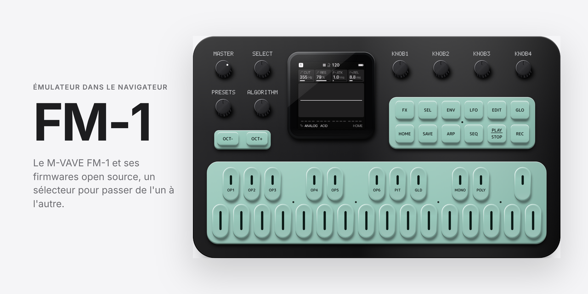

# FM-1

Le M-VAVE FM-1 dans le navigateur. Un même panneau fait tourner la réimplémentation FM-1+VA ou l'un des 114 firmwares open source du FM-1, que l'on choisit dans un sélecteur.

**Ouvrir : [ninjathune-human.github.io/Fm1](https://ninjathune-human.github.io/Fm1/)**

Chrome, Edge, Firefox et Safari récents, sur ordinateur, iPad et iPhone : souris, tactile et stylet.

## Utilisation

1. **Allumer** démarre le son et le firmware choisi.
2. Le contrôle **Firmware**, sous le panneau, ouvre la liste. La recherche accepte les fautes de frappe et les mots dans n'importe quel ordre ; Entrée démarre le premier résultat.
3. Toucher une ligne démarre le firmware. Chaque firmware garde ses presets et ses patterns dans le navigateur, séparément des autres.
4. **Ouvrir un .fwsc…** démarre un paquet de votre ordinateur. Il n'est envoyé nulle part.
5. L'interrupteur **marche / arrêt**, sous le panneau, allume le FM-1. L'éteindre efface les sauvegardes du seul firmware actif.

Marqueurs de la liste : « bêta » (version de test de son auteur), « en ligne » (paquet chargé depuis le FM-1 Firmware Hub), « non évalué » (pas encore essayé dans l'émulateur).

## Comment ça marche

- **FM-1+VA** est une réimplémentation écrite d'après le manuel publié par Baud Girl : moteurs FM, Virtual Analog et 8-Bit, écrans et séquenceur. Ce n'est pas son firmware : FM-1+VA de Baud Girl n'est pas redistribué ici, et la réimplémentation ne reprend aucun code de son firmware.
- **Les autres firmwares** tournent tels quels sur [fm1-emu](https://github.com/joakimeriksson/fm1-emu), l'émulateur de la puce JieLi AC791N du FM-1 écrit par Joakim Eriksson. À chaque mise à jour du dépôt, une action GitHub le compile en WebAssembly au commit figé `1c8661d`, puis publie le site.
- **57 firmwares tournent en natif** : compilés depuis leurs sources pour le navigateur, sans processeur émulé (voir [performances](docs/performance.md)). Leur paquet émulé n'est plus dans le dépôt ; si leur compilation manquait, la page les émulerait depuis le paquet en ligne du FM-1 Firmware Hub.
- Les paquets `.fwsc` sont ceux publiés par leurs auteurs, vérifiés par leur empreinte SHA-256 ([catalogue](firmwares/catalogue.json)). Chacun a été démarré dans l'émulateur : voir le [rapport de vérification](docs/verification.md).

## Firmwares

« État » : vérifié (démarré ici, image et son mesurés), fonctionne (déclaré fonctionnel par fm1-emu), non évalué ; « natif » : compilé depuis ses sources, sans émulation.

<!-- firmwares -->
### Officiel (1)

| Firmware | Auteur | Licence | Source | État |
|---|---|---|---|---|
| M-VAVE officiel V15 | M-VAVE | Apache-2.0 | [4c7496d](https://github.com/m-vave/fm1_open/tree/4c7496daac04a95ff10d1afdcc8f9ead2dbabc41) | fonctionne |

### Groovebox (41)

| Firmware | Auteur | Licence | Source | État |
|---|---|---|---|---|
| Chipbox | Pasquale Barilla | GPL-3.0 | [4851031](https://github.com/pbarilla/chipbox/tree/48510318cffe4db2a5ceccfc153a65dcd6c8d6ff) | fonctionne, natif |
| DUB-1 | sbegueria | GPL-3.0 | [e6fe7b8](https://github.com/sbegueria/fm1-dub/tree/e6fe7b8f8f3114019bb36b5b536ad458eacd2c2d) | fonctionne, natif |
| ESTAMPIE | Drew Robinson | GPL-3.0 | [b6be8f7](https://github.com/ocean/estampie/tree/b6be8f78adcee97d4b217db7b81f6a4eb02445e8) | vérifié, bêta, natif |
| Felucca | Leo Kuroshita (Hügelton Instruments) | GPL-3.0 | [a53ecf4](https://github.com/hugelton/Felucca/tree/a53ecf428c29c780108fd70a31b71a32a6b5c313) | fonctionne, natif |
| Felucca 8 Patterns | echoe | GPL-3.0 | [21fc592](https://github.com/echoe/Felucca_8_patterns/tree/21fc592dab76907b6bea34d97950dfe129ad9fd8) | fonctionne, natif |
| Felucca [Salt] | Chance Roth (ChanceTheMaker) | GPL-3.0 | [9490527](https://github.com/ChanceTheMaker/Felucca/tree/949052728758229ab5ab1816ccf9fa61fafc5803) | fonctionne, bêta |
| FIZZ | Quixotic7 | MPL-2.0 | [664d981](https://github.com/Quixotic7/FIZZ/tree/664d9812e32d5c24a0f3a89b429d35ccac1a9b32) | vérifié, bêta |
| FM1-GM | jartificer | GPL-3.0 | [fcc7655](https://github.com/jartificer/fm1-gm/tree/fcc7655dd0bfe5a29440f99dbcadba417cf1dbc7) | fonctionne |
| GHOULBOX | Jason Persinger | GPL-3.0 | [9f2b9a2](https://github.com/jasonpersinger/ghoulbox-fm1-dungeon-synth/tree/9f2b9a22e456d7fe9552b40f7a1d0c13200913bb) | fonctionne, natif |
| Golana DZ Edition | dzwerg | GPL-3.0 | [858e3f2](https://github.com/dzwerg/Golana-DZ/tree/858e3f2f9e018f01a1c87451c712193869f0324b) | fonctionne, bêta, natif |
| GR!MM | GRiMMBIENT | GPL-3.0 | [815ca6b](https://github.com/GRiMMBIENT/grimm/tree/815ca6be81d973445851238dbaf12b4536d1e6d8) | fonctionne, natif |
| HERA | Ben Badio | GPL-3.0 | [2c99af2](https://github.com/benbadio/hera-fm1/tree/2c99af2141217e1e0083da39049ace432efa1cd1) | fonctionne, natif |
| HYP-1 | RedtailWorks | GPL-3.0 | [57c456d](https://github.com/RustyPawz/fm1-HYP1/tree/57c456db61826331d356458c9c1a136517da7cbf) | fonctionne, en ligne |
| Jangada | zednaked | GPL-3.0 | [46e6c2c](https://github.com/zednaked/jangada/tree/46e6c2c2ed94b609918aa6f5f7381fac915ffc45) | fonctionne |
| JIANT FM | juanjiant-bit | GPL-3.0 | [c6e7aa1](https://github.com/juanjiant-bit/JIANT/tree/c6e7aa189525043806e6b3052dd1f8b3c39c3e33) | fonctionne, bêta, natif |
| Loom FM-1 | Co-oscillator | GPL-3.0 | [ed6f036](https://github.com/Co-oscillator/Loom-FM-1/tree/ed6f036f9e3187ba22f915c3941d23f477159683) | vérifié, bêta, natif |
| LOOM-8 | Charles Vestal | MPL-2.0 | [92b4bf2](https://github.com/charlesvestal/fm1-loom/tree/92b4bf2c080b0a4172c07e4cf499dd6d557c3f5f) | fonctionne, bêta |
| Makohai | delirioux | GPL-3.0 | [800edc8](https://github.com/delirioux/makohai/tree/800edc8a88d2a883fbeb2cf198a976d7769f3707) | vérifié, natif |
| MAKU | okumurari | GPL-3.0 | [5671198](https://github.com/okumurari2/maku/tree/5671198f1989cbd4a0e674b2059e7f8316faf37d) | fonctionne, natif |
| MC-1 | dspaudio | GPL-3.0 | [10a2240](https://github.com/dspaudio/mc-1/tree/10a2240d7f3c63e3ed551774a8e17fb24ed002b8) | fonctionne |
| Melodee | keremimo | GPL-3.0 | [f40dd70](https://github.com/keremimo/melodee/tree/f40dd70fd8b497b5372ee5de886e4dfae1cd8062) | fonctionne, bêta |
| Mini-Tone | Stéphane Schmitz | GPL-3.0 | [6803c6c](https://github.com/eldontyrellcorp/Mini-Tone/tree/6803c6c29e3402fcc0c4af7c2050df987d9b66b5) | fonctionne, natif |
| MNM-1 | Veff | GPL-3.0 | [2c7aee4](https://github.com/galfaroth/mnm1/tree/2c7aee4c277bb642404c4638dbc77a360d36cf55) | vérifié |
| MONO2K | Iñigo Hernandez | GPL-3.0 | [b52d677](https://github.com/InigoHernandez/mono2k/tree/b52d67703d4728c176c685c27d213f0c4da52232) | vérifié, natif |
| Mutable Dreams | Kid Bunka | GPL-3.0 | [04cf468](https://github.com/kidbee85-beep/mutable-dreams/tree/04cf468420f4325f6bdbbecfd59695b06c481a8a) | fonctionne |
| MYCELIUM | Mandalars | GPL-3.0 | [750eb12](https://github.com/megagott/mycelium-fm1/tree/750eb125e2850acc62a8391cb742246a7c437745) | fonctionne, bêta |
| ORBIT | dspaudio | GPL-3.0 | [3cbd250](https://github.com/dspaudio/orbit/tree/3cbd2502ddd375484574837ae8e7e6a46c5c1e2d) | fonctionne, bêta |
| PERF-1 | deamonSLINKY | GPL-3.0 | [d2ed6aa](https://github.com/deamonSLINKY/PERF-1/tree/d2ed6aa95867dd5b395eee36fb447bcb99b9949b) | vérifié, bêta |
| Pocket GammaWave | ShadowTune (GammaWave Audio) | GPL-3.0 | [8bf1a12](https://github.com/fvalente/GammaWave-FM1/tree/8bf1a12cdb7c70e86eba81e63cb374d14f9d43e2) | fonctionne, natif |
| Polly | Charles Vestal | GPL-3.0 | [62cd07e](https://github.com/charlesvestal/fm1-polly/tree/62cd07ea7c95c30021c31e957cea8be448415fa7) | fonctionne, bêta, natif |
| Ravel | De-Pattern | GPL-3.0 | [6a7696d](https://github.com/De-Pattern/Ravel_FM1/tree/6a7696d75ae4ffaeff21827f973abf2b93771326) | vérifié, bêta, natif |
| Skiff | illuminus5 | GPL-3.0 | [c01fa1e](https://github.com/illuminus5/skiff/tree/c01fa1ed619266d770ea6552b153612e1b77d0a9) | fonctionne, natif |
| SLOOP | isod89 | GPL-3.0 | [d893642](https://github.com/isod89/sloop-fm1/tree/d89364253b79a5c6002c0d90c5f16b3c3c16ea9d) | fonctionne |
| SLOOP DX7 Banks | majnikool | GPL-3.0 | [c741193](https://github.com/majnikool/sloop-fm1/tree/c741193ba46b20994d70526f92cf160006be513b) | fonctionne, bêta |
| sloopDX | zvenson | GPL-3.0 | [9870b84](https://github.com/zvenson/dxsloop/tree/9870b846e77a123aafc84786b4bedfd1d53ac0f7) | fonctionne |
| Tessera | Theo Dainis (Rastapopolix) | GPL-3.0 | [094f535](https://github.com/Rastapopolix/tessera/tree/094f53582cc4bc04d62e95537eb2ff22264f4819) | fonctionne, natif |
| TRIBE | apiel | GPL-3.0 | [29664b2](https://github.com/apiel/fm1-tribe/tree/29664b28c9d8b8eb043de0739bf9dd64869958c4) | fonctionne, bêta, natif |
| WaveLoop FM-1 | ELI7VH | GPL-3.0 | [7bce760](https://github.com/ELI7VH/Felucca/tree/7bce76090a076cf488ac03b53c83960b7c14e81e) | fonctionne, natif |
| winampFM Synth | Hericdk | GPL-3.0 | [54575a4](https://github.com/hericdk/winampFM/tree/54575a4bb81e2769bd3f4ae03d0af5e80785b7cf) | fonctionne, bêta |
| X0X | Charles Vestal | GPL-3.0 | [27f6fac](https://github.com/charlesvestal/fm1-x0x/tree/27f6fac7e07ce97b5de158b45aec99f59a9e23fd) | fonctionne, natif |
| X0X-RMX | Mr-Roboto (Oliver) | GPL-3.0 | [a4e78f3](https://github.com/Mr-Roboto/fm1-x0x-rmx/tree/a4e78f3a6e16fa310b7614e5876d07e16a0020f9) | fonctionne, natif |

### Synthé (40)

| Firmware | Auteur | Licence | Source | État |
|---|---|---|---|---|
| AMB-1 | Charles Vestal | MPL-2.0 | [188b0a4](https://github.com/charlesvestal/fm1-amb/tree/188b0a42f20a547864e732ae5ea1339d0fbcf395) | fonctionne |
| Arctic Scream | p0larpatch | GPL-3.0 | [7b5b8b2](https://github.com/PolarPatch/Arctic-scream-FM-1/tree/7b5b8b261bf8ea4d5d64485c082636c5b1579854) | vérifié, natif |
| Bunker Evolved | Kid Bunka | GPL-3.0 | [c9bb0b1](https://github.com/kidbee85-beep/bunker-evolved/tree/c9bb0b1ac4a7dbb420a3f452fc75b705981ab0f4) | fonctionne, natif |
| Bytemania | lloyd (llozd) | GPL-3.0 | [e670b35](https://github.com/llozd/bytemania/tree/e670b35369f8556ee82683f35c6b8bfbcb366155) | fonctionne |
| Caravel | BonszaiMusic | GPL-3.0 | [b50bad5](https://github.com/bonszaimusic/caravel/tree/b50bad57dcf32862f36661a5fc2996e13392b93e) | vérifié, bêta, natif |
| Carnac OS | OrbVorgis | GPL-3.0 | [be8cc10](https://github.com/OwenKirby/carnac-os/tree/be8cc104f3618ba9b12c834827abfdbb4e1686af) | fonctionne, bêta, natif |
| Clipper | isod89 | GPL-3.0 | [e690672](https://github.com/isod89/clipper-fm1/tree/e69067211c4690f34e494b5b896e4585163dcc2b) | fonctionne, bêta |
| CS-1 | twochannels | GPL-3.0 | [5dce8fa](https://github.com/twochannels/CS-1/tree/5dce8fadd3aa86cf47a3290289ee1c10b7c102e4) | fonctionne, natif |
| DRIFT | FBNFRTG | GPL-3.0 | [09b5b98](https://github.com/FBNFRTG/drift-fm1/tree/09b5b981f350a37055467d560702af8608f65ad1) | fonctionne, bêta, natif |
| DUELL | OSCILL/R | GPL-3.0 | [33e2e2e](https://github.com/oscillr/DUELL/tree/33e2e2ed36a9d1a33a39ac1d1f06282c9045aab0) | fonctionne, natif |
| ETCH | SikkenWorks | GPL-3.0 | [57676c0](https://github.com/SikkenWorks/ETCH/tree/57676c0e321bc08e54682585509529a0b581749c) | fonctionne |
| Evander's Music Box | Michail Tsakiroglou | GPL-3.0-or-later | [53c3234](https://github.com/MikeTsak/Evanders-Music-Box--FM-1-LARP-firmware/tree/53c32342efb4b06c7f40ae4758279c5c361c5535) | fonctionne |
| FiMba-1 | jadamsowers | GPL-3.0 | [0485ed0](https://github.com/jadamsowers/fm1-fimba/tree/0485ed0d387ce78216428c7b19f97d77bbe10b4d) | fonctionne, bêta, natif |
| FM-1 SID | joakimeriksson | GPL-3.0 | [2260253](https://github.com/joakimeriksson/fm1-sid/tree/2260253df0c614e507cd7d346d9771f4d353a820) | fonctionne |
| FM-106 | PatttF | GPL-3.0 | [3833499](https://github.com/PatttF/fm-106/tree/3833499bfd0f2f4df522793526690f743b7164c9) | fonctionne, bêta, natif |
| FMEL-1 | Antonio Altea | GPL-3.0 | [2d69b38](https://github.com/AntonioAltea/fmel-1/tree/2d69b3892a2eac2ed6f4eef1d82cf5d6de9c87a8) | fonctionne, natif |
| FMini-1 | Ruppert | GPL-3.0 | [ab0f5c8](https://github.com/ruppert/fmini-1/tree/ab0f5c83d9c3b8cf10fd2f9ef3dc760a06c3abb3) | fonctionne, natif |
| FRASIL | Styves Goupil | MPL-2.0 | [422cac6](https://github.com/styvesgoupil/frasil/tree/422cac668d2753cda4e76e07d5a1f26bf4b1007e) | fonctionne |
| Frodhes | Leonardo Mirabal | GPL-3.0 | [33c9730](https://github.com/leonardoMirabal/frodhes/tree/33c9730c04f1c72b1319aec68124b8759419fd68) | fonctionne, bêta, natif |
| GATOR | ivanvoid | GPL-3.0 | [92f923e](https://github.com/npi3pak/fm1-gator/tree/92f923e0b9fe6101d5cd422cffa5946ce20d785a) | vérifié, bêta |
| Golana | Gadlele | GPL-3.0 | [472914d](https://github.com/Gadlele/Golana/tree/472914d794fb879eb502f62d3380a3b674ab2547) | fonctionne, natif |
| J6 | JackieAlacrity2373 | MPL-2.0 | [1f3fbdb](https://github.com/JackieAlacrity2373/fm1-j6/tree/1f3fbdbd2dc46a2477b2ea976a4b3e8a7405d4e2) | vérifié |
| Matryoshka | glvno | GPL-3.0 | [e3145af](https://github.com/glvno/matryoshka/tree/e3145af6c7327e0c988ac08b079cc319bb428bc0) | vérifié |
| MODELAR | Hirakos | MPL-2.0 | [89475ca](https://github.com/hirakos999/MODELAR/tree/89475ca2586d6861cc35cd62ea2e1f23a574d9cc) | fonctionne, bêta |
| MONK-1 | Charles Vestal | GPL-3.0 | [b21a361](https://github.com/charlesvestal/fm1-monk/tree/b21a361ea43b04b38b7598d35eb1ca651baaa661) | fonctionne, bêta, natif |
| Monohull | Mark White | GPL-3.0 | [8590e27](https://github.com/markterm/monohull/tree/8590e27dc9d4e080d1d4f585036c97df44940a71) | vérifié, bêta |
| MOPE-1 | slothpallas | GPL-3.0-only | [59be1e7](https://github.com/slothpallas/mope-1/tree/59be1e7a5d01b94ba039f4c1c50d32cb734fc1c1) | vérifié, bêta, natif |
| Niagara Drift | evanyerburgh | GPL-3.0 | [802daa8](https://github.com/evanyerburgh/niagara-drift/tree/802daa818af060293cae77afec013df3dec0a060) | fonctionne, bêta, natif |
| NOIZ DEMONS | SPIKE the Percussionist | GPL-3.0 | [4fe0f1a](https://github.com/SPIKE-the-Percussionist/noiz_demons/tree/4fe0f1afb4d97f56dfb763c176679fe6e059ecec) | fonctionne, natif |
| OberVave | zvenson | GPL-3.0 | [dc4e5d3](https://github.com/zvenson/obervave/tree/dc4e5d33b09f5e3f927801d78085f26171e9c7b8) | fonctionne, natif |
| OPN-1 | putchdev | GPL-3.0 | [960c103](https://github.com/putchdev/opn-1/tree/960c1038cb660788026c8136467e99597019a333) | fonctionne |
| S1Vave | Andrew GG | GPL-3.0 | [9730337](https://github.com/AndrewGG88/S1Vave/tree/97303378678c247ca1d005ae641114f4544acf65) | non évalué, natif |
| Shine On | zvenson | GPL-3.0 | [2f37738](https://github.com/zvenson/shineon/tree/2f37738d690a628e0ae1d23d07ea5ee3eeda2de7) | fonctionne, natif |
| SID-1 | putchdev | GPL-3.0 | [1d0555b](https://github.com/putchdev/sid-1/tree/1d0555b784173bb61e3e371ccedfbe8ff2559d18) | fonctionne |
| SLOOP Floyd FM | René Bohne | GPL-3.0 | [f8f9f9d](https://github.com/renebohne/sloop-fm1/tree/f8f9f9d021bb5c9d60b01aa9d43e0d1e6d118a85) | fonctionne |
| TastyWaves | marksweiss | GPL-3.0 | [15fd698](https://github.com/marksweiss/tastywaves/tree/15fd6986007ef51965303d7fd6410493e89c9ff4) | vérifié |
| Tonitor | Nuno Zimas | GPL-3.0 | [0dccfca](https://github.com/nzimas/tonitor/tree/0dccfcaed372368dd1519db22f4f4c5a109132d0) | fonctionne |
| Unholy Union | actuallysparky | GPL-3.0 | [3c0dfd9](https://github.com/actuallysparky/FM-1-Unholy-Union-generative-drone-firmware/tree/3c0dfd93571774a0a2386bd1d2bc2b80de48fdfb) | fonctionne, bêta, natif |
| Vector37 | genkigenki | GPL-3.0 | [08742a4](https://github.com/genkigenki/Vector37/tree/08742a4198f99e2db2846b00b70ed6808239c447) | fonctionne, bêta, en ligne |
| ZEN-1 | aceyprime | GPL-3.0 | [ec92952](https://github.com/aceyprime/zen-1/tree/ec9295233ea64ddac224b58b4d07216706c1b8ee) | fonctionne, natif |

### Accords (6)

| Firmware | Auteur | Licence | Source | État |
|---|---|---|---|---|
| ChoralRoot | Quixotic7 | GPL-3.0 | [070bd30](https://github.com/Quixotic7/ChoralRootFM1/tree/070bd306ed63c7d08f09bb6ea937262b52b1a6c0) | fonctionne, bêta, natif |
| CoralFlower | FicusFicusov | GPL-3.0 | [b5ceb99](https://github.com/FicusFicusov/CoralFlower/tree/b5ceb997be330c8a420958eb8f4e0f4b3ca084c2) | fonctionne, bêta, natif |
| fm1-chord | math0ne | GPL-3.0 | [377235d](https://github.com/math0ne/fm1-chord/tree/377235d9f39a362e673f8fd60a26f0b1748218e7) | fonctionne, bêta |
| FoMni | Charles Vestal | GPL-3.0 | [6ecd227](https://github.com/charlesvestal/fm1-fomni/tree/6ecd227013cc18def0e89d035b3760eb268b342b) | fonctionne, bêta, natif |
| FuMi-1 | cartesive | GPL-3.0 | [6a20fa3](https://github.com/cartesive/fumi-1/tree/6a20fa387cf6bc28a33309a09aaa94a108325e2e) | fonctionne, natif |
| GuitChordi | Stoogs | GPL-3.0 | [09a4f17](https://github.com/stoogs/guitchordi/tree/09a4f170d76e7e6b1fad6cb3f3609553eabaf498) | vérifié, bêta |

### Boîte à rythmes (6)

| Firmware | Auteur | Licence | Source | État |
|---|---|---|---|---|
| Cut-A-Dor | Kid Bunka | GPL-3.0 | [d9799ab](https://github.com/kidbee85-beep/cut-a-dor-release/tree/d9799abb84fef0cc59deb05e2f6a4c41032c32f1) | fonctionne |
| Del Rio | Jess Del Rio | MPL-2.0 | [c604e56](https://github.com/jsopdebeeck/fm1-delrio/tree/c604e5659b4505c98788b30982364289a8348178) | fonctionne, bêta |
| FOMAJAM | konsumer | GPL-3.0 | [a80681b](https://github.com/konsumer/fomajam/tree/a80681b6102c731b5b84b2469d5a67d18ee5f5aa) | fonctionne, bêta |
| Hortator | DEADACTIVE | GPL-3.0 | [9aa704b](https://github.com/deadactive/hortator/tree/9aa704bb9129516ec9d86c056dff5995282093b2) | fonctionne, bêta |
| PIGEON | The Shrimp Blimp | GPL-3.0 | [48f028f](https://github.com/TheShrimpBlimp/pigeon/tree/48f028f2ee7f6a0140dfef9d9426dc3237f2e466) | fonctionne, bêta, natif |
| zp12 | zvenson | GPL-3.0 | [7b8b975](https://github.com/zvenson/zp12/tree/7b8b97586ef87854d1859aad907e5f10ca49898d) | fonctionne |

### Tracker (4)

| Firmware | Auteur | Licence | Source | État |
|---|---|---|---|---|
| BEETLE | Joppe Sikken (SikkenWorks) | GPL-3.0 | [c8b286a](https://github.com/SikkenWorks/BEETLE/tree/c8b286a9445cfc9798e117835ceac3bd5e92c49f) | fonctionne |
| KAWA | Omnipotard (Guizmoh) | GPL-3.0 | [a101686](https://github.com/Guizmoh/Kawa-Tracker-Fm1/tree/a10168605cb86276f55d8164d1c89ded7e3852aa) | fonctionne, bêta, en ligne |
| Ketch | risseraka | GPL-3.0 | [58146f3](https://github.com/risseraka/fm1-tracker-ketch/tree/58146f3509861506fa5cfdb5e1c01172aba4955e) | fonctionne, bêta |
| SIDOU | Denis Sablić | GPL-3.0 | [f508588](https://github.com/dsablic/sidou/tree/f50858880db57d301eafefac4883045591497884) | fonctionne, bêta |

### Autre (16)

| Firmware | Auteur | Licence | Source | État |
|---|---|---|---|---|
| 386DX | seajaysec | GPL-3.0 | [2caa8fb](https://github.com/seajaysec/386-DX-FM1-KaraokeBot/tree/2caa8fbb990a108d1856496b54d83519bb0f2ba8) | fonctionne |
| Berlinan | Jiří Píša | GPL-2.0-or-later | [afe2d93](https://github.com/jiripisa/fm1-berlinan/tree/afe2d937442fd248d145a34e8907d1c67ee4c3d6) | vérifié, bêta |
| CTL-1 | Charles Vestal | MPL-2.0 | [c3c2a7e](https://github.com/charlesvestal/fm1-ctl/tree/c3c2a7e51f3d14dd7a94f8b3775e838f097ec367) | fonctionne |
| Dinghy | zvenson | GPL-3.0 | [7c31bb2](https://github.com/zvenson/dinghy/tree/7c31bb25c90cc11b2a94f1a10f549d0817884ac1) | fonctionne, bêta |
| Fart Machine One | adamcharleswilsonmusic-code | GPL-3.0 | [5e49a21](https://github.com/adamcharleswilsonmusic-code/Fart-Machine-One/tree/5e49a216c18c6e0a7e5e42bef43843b40ad9ea5f) | fonctionne, natif |
| Flyfish | delirioux | GPL-3.0 | [4e5efb8](https://github.com/delirioux/flyfish/tree/4e5efb8a7623cfb19a55fdc08cb12e8cfdfce578) | fonctionne, natif |
| FM-1 Doom | zvenson | GPL-3.0 | [640bc2d](https://github.com/zvenson/fm1doom/tree/640bc2dbdc69bcaf045afb9ef3695274f49fed4c) | fonctionne |
| FM1 Quest | Hericdk | GPL-3.0 | [0996503](https://github.com/hericdk/fm1-quest/tree/0996503bfe83c8c2217c63b29e1be75ebbcdddaf) | fonctionne |
| fm1-dock | joakimeriksson | GPL-3.0 | [3ead086](https://github.com/joakimeriksson/fm1-dock/tree/3ead086893b0a0bc1cf139c1b1234b86461fda56) | fonctionne |
| MIDIMON | ignis32 | MPL-2.0 | [e00e863](https://github.com/ignis32/midimonitor_fm1/tree/e00e86395363c61367d1d260e75116a6e6d03cea) | vérifié, bêta |
| MIN-1 | Reytian | GPL-3.0 | [8d6dd77](https://github.com/Reytian/fm1-min1/tree/8d6dd77d34cde4f980bd84e726d6a923f951a0dd) | fonctionne, bêta, natif |
| MORPHEUS | Ben Badio | GPL-3.0 | [945c40c](https://github.com/benbadio/morpheus-fm1/tree/945c40c299273903922e5da75f79b559f621d8c4) | fonctionne, en ligne |
| No Man Sky FM | Hericdk | GPL-3.0 | [32e7f4c](https://github.com/hericdk/nomanskyFM/tree/32e7f4c14a5e9f468d7fde69c91d78b3e0424f61) | fonctionne, bêta |
| PurpleMonkey | Quixotic7 | GPL-3.0 | [7590d4a](https://github.com/Quixotic7/PurpleMonkeyFM1/tree/7590d4a5205bd4932b206d676c09b9521843a023) | fonctionne, bêta, natif |
| Rainbow Mode | joshbartlettband-web | GPL-3.0 | [0baf362](https://github.com/joshbartlettband-web/felucca-rainbow/tree/0baf362731c65398ad963229a3fe5500c75c6e3e) | fonctionne, natif |
| Tuna | delirioux | GPL-3.0 | [f06047d](https://github.com/delirioux/tuna/tree/f06047dc7e4a4c061818b9a29f5412359a2fb607) | fonctionne, natif |
<!-- /firmwares -->

## Licences et crédits

- **fm1-emu** : licence MIT, © 2026 Joakim Eriksson. Ses fichiers d'exécution sont publiés avec leur licence (`runtime/LICENSE-fm1-emu.txt`).
- **Firmwares** : chacun reste sous la licence de son auteur (GPL-3.0 pour la plupart, MPL-2.0 pour neuf d'entre eux, Apache-2.0 pour le firmware officiel V15). Les textes sont dans `firmwares/licences/`, et la colonne « Source » renvoie au code source exact de chaque paquet.
- **Catalogue** : établi d'après le [FM-1 Firmware Hub](https://thefirmwarehub.com/) de zvenson.
- **FM-1+VA** est une création de Baud Girl ([baudgirl.com](https://baudgirl.com/work/FM-1+VA)) ; son firmware n'est pas redistribué ici.
- M-VAVE et FM-1 sont des marques de leurs propriétaires. Projet indépendant, sans lien avec M-VAVE.
